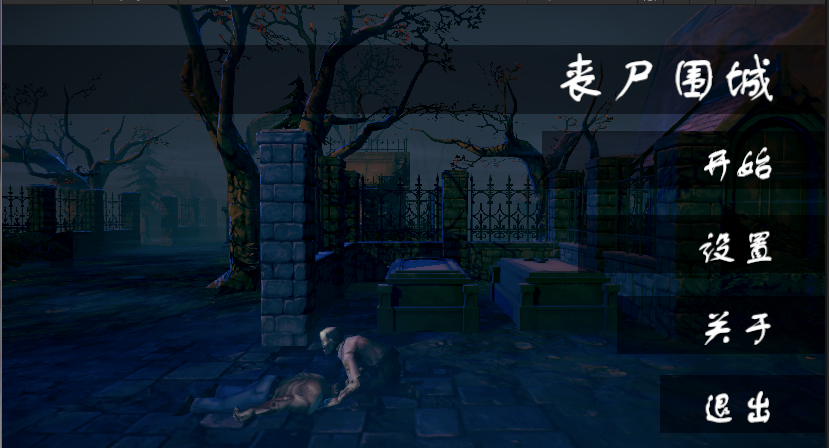
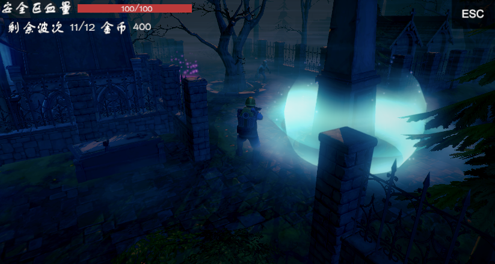

# 丧尸围城 · Unity 塔防 Demo

> 基于 Unity 2023.2 的 3D 塔防：波次刷怪、造塔升级、主塔防守。

## 玩法

- 选关后进入战斗，敌人从出怪点按波次刷出，沿寻路路线进攻主塔
- 在造塔点消耗金币建造防御塔，可逐级升级，等级越高伤害/射程越强
- 主塔血量归零即失败，通关弹出结算面板并发放奖励

| 开始界面 | 游戏画面 |
|:---:|:---:|
|  |  |

## 核心实现

| 模块 | 位置 | 说明 |
|---|---|---|
| 关卡与波次 | `Assets/Scripts/GameScene/GameLevelMgr.cs` | 单例，管理出怪点、怪物列表、当前/最大波次，初始化玩家与 UI |
| 造塔与升级 | `Assets/Scripts/GameScene/TowerPoint.cs` | `CreateTower(id, levelIndex)`：查配表 → 校验金币 → 扣费 → 实例化 → 记录当前等级 |
| 主塔与胜负 | `Assets/Scripts/GameScene/Object/MainTower.cs` | 血量更新，归零后弹出 `GameLosePanel`，用 `isWin` 区分通关/失败 |
| 敌人 AI | `Assets/Scripts/GameScene/Object/MonsterObj.cs` | `NavMeshAgent` 寻路，`Animator` 播放受击/死亡，速度取自配表 |
| 数据配表 | `Assets/Scripts/Data/`、`Assets/Scripts/Json/JsonMgr.cs` | LitJson 解析 JSON：塔、塔等级、怪物、角色、场景、音乐 |
| UI 框架 | `Assets/Scripts/UI/UIMgr.cs`、`UI/BasePanel.cs` | 泛型面板管理，按层显示/隐藏 |
| 场景切换 | `Assets/Scripts/BeginScene/UI/ChooseScenePanel.cs` | `SceneManager.LoadSceneAsync` 异步加载战斗场景 |

## 技术要点

- 单例 + 分层管理器组织流程：`GameLevelMgr`（战斗）/ `GameDataMgr`（存档与配置）/ `UIMgr`（界面）
- 配置驱动：塔与怪物的数值全部走 JSON，调平衡不用改代码
- `Resources.Load` 运行时加载预制体与动画控制器
- 基于 `NavMeshAgent` 的怪物寻路，波次越高数量与强度越大

## 运行

1. Unity Hub 添加本目录，Editor 版本 **2023.2.20f1c1**
2. 首次打开会自动从 `Packages/manifest.json` 还原依赖
3. 打开 `Assets/Scenes/BeginScene.unity` 运行

## 关于美术资源

`Assets/ArtRes/` 未纳入版本库（第三方 Asset Store 资源，含授权限制）。
clone 后需自行导入以下资源包，否则场景会丢失贴图/模型：

- PureNature
- Top-Down Graveyard
- Tower Defense
- MagicArsenal
- Unique Projectiles Vol.1
- Toon Soldiers / Toon Zombies

## 目录

- `Assets/Scripts/` — 31 个自研 C# 脚本 + LitJson（第三方 JSON 库）
- `Assets/Scenes/` — `BeginScene`（主菜单/选关）、`GameScene1`（战斗）
- `Assets/Resources/` — 预制体、贴图、音频、配表
